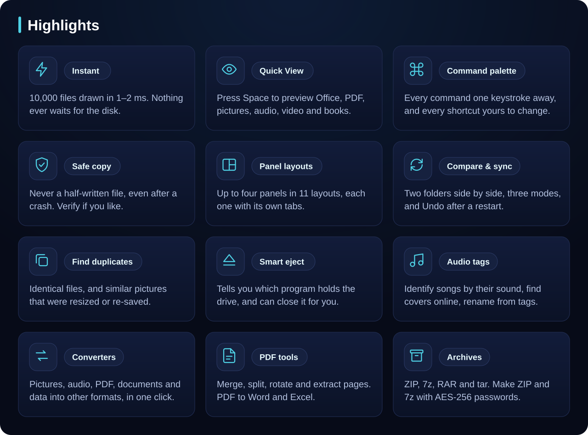
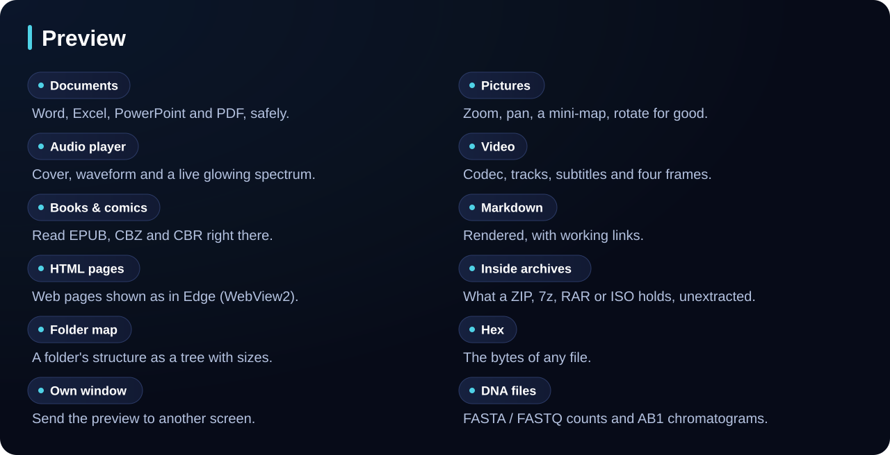
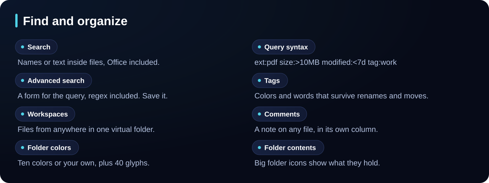
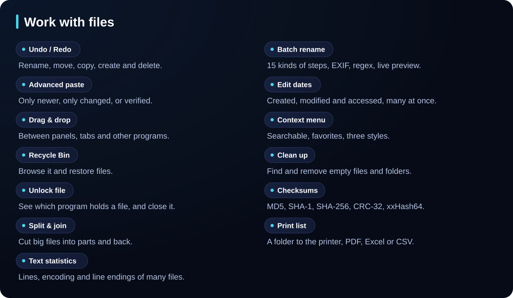
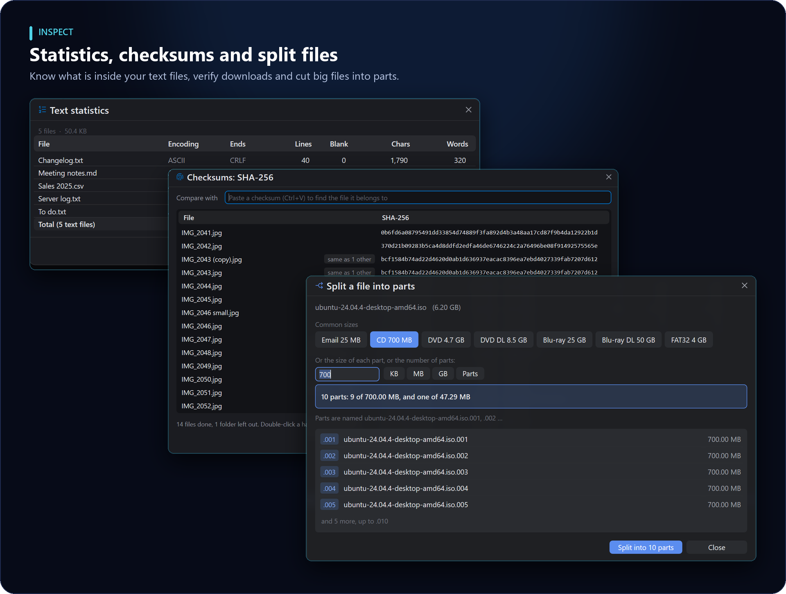
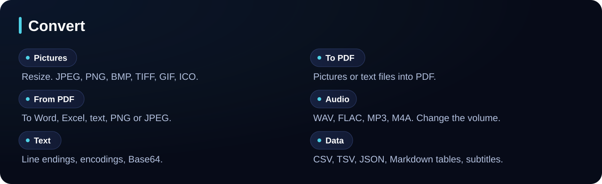
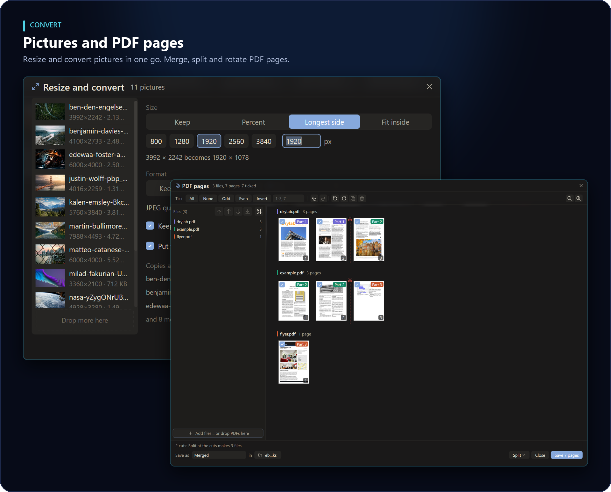
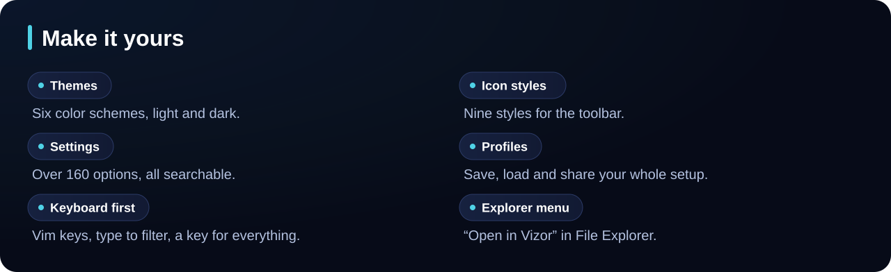

<p align="center">
  
</p>

# Vixor

**A fast, native file manager for Windows with a built-in preview, command palette and everyday tools.** It is a single `.exe` written in C (Win32 + Direct2D/DirectWrite + WIC), with no account and no telemetry. Vixor only goes online when you ask it to: identifying a song or finding its cover (the audio tag tools) sends the sound's fingerprint or a search to AcoustID, MusicBrainz and the Cover Art Archive, and, only if you say yes, once a week it checks GitHub for a newer version. Nothing else leaves your computer. Folders of 10,000 files are drawn in 1–2 ms, and reading a folder never freezes the window.

Press **Space** to preview almost anything (Office, PDF, pictures, audio, video, books), work with up to four panels that each have their own tabs, and reach every command from the **command palette** (Ctrl+Shift+P). Copies are never left half-written, even after a crash. The everyday jobs that usually send you to another program are already inside: batch rename, find duplicates, compare and synchronize folders, checksums, PDF tools, converters, archives (ZIP, 7z, RAR, tar) and audio tags.

**Built on the best ideas that already exist.** Vixor borrows what each kind of tool does well: the dual panels and keyboard speed of the classic file managers, the Columns view and the quick preview of the macOS Finder, the instant search of the best desktop search tools, and the command palette of modern code editors. It brings them together in one program that feels native on Windows.

**Who is it for?** Anyone who finds Explorer slow or too limited, who handles many files every day (photos, documents, music, backups) and wants to do it without reaching for the mouse or a dozen small utilities.

**What it is not:** a replacement for professional software. The built-in tools do the basic, everyday work; a full PDF editor, a photo editor or a backup suite will go much further.

**Status:** beta, ready to use.

**Requirements:** Windows 10 or 11, 64-bit. A processor with 2 or more cores and 4 GB of RAM are enough to use it; 4 cores and 8 GB or more are recommended. Vixor uses several threads to keep the window responsive while it reads folders, sizes, thumbnails and previews, so a very old single-core processor will feel slow. Using it on an SSD is highly recommended.

## The story behind Vixor

Like many Windows Explorer users, I always wished for a better response, more built-in utilities and many more ways to make it my own. Several tools already improve on Explorer, but none of them had all the features I wanted in a file manager.

I had this idea for years: one file manager that already does what I kept installing separate tools for. Renaming in batches, finding duplicates, converting files, compressing, previewing, comparing folders. At some point I counted eight or ten different programs on my computer just to look after my files, and having to find, download and update each one was tedious. I never had the skills to build the tool I imagined. With AI, I finally could.

Vixor has taken more than 200 hours. It is 100% vibe coded, but every architecture and design decision was mine, and I reviewed every detail myself, one by one.

I also wanted it to be trustworthy, because a file manager must never lose your files. That is why testing was as much a part of the work as writing the code; you can read how below.

Vixor is free, with no ads, no account and no locked features, and it will stay that way. If it turns out to be useful to you and you would like to support this project, you will find me on [Ko-fi](https://ko-fi.com/edukode). It is never expected: using Vixor and telling me what to improve is already a great way to help.

<details>
<summary><b>How it was tested</b></summary>


- Automated tests run on every build; a single failing check stops it, and compiler warnings count as errors.
- Static analysis of the whole code before every commit, with no warnings accepted.
- A debug build with AddressSanitizer, which catches memory errors that normal testing misses.
- Fuzzing: the code that reads untrusted files (archives, documents) is fed with random and malformed files to see if it breaks.
- Stress tests for copying and deleting, because losing a user's data is the worst possible bug.
- More than ten audit rounds of the whole program (errors, data safety, untrusted files, threads, logic, performance). Every finding was rated by severity and written down with how it was checked, and nothing was called fixed until it had been run.
- Every change tried by hand in the real app before it was committed.

</details>

## Features

<p align="center"></p>
<p align="center"></p>
<p align="center"></p>
<p align="center"></p>
<p align="center"></p>
<p align="center"></p>
<p align="center"></p>
<p align="center"></p>
<p align="center"></p>
<p align="center"></p>
<p align="center"></p>
<p align="center"></p>
<p align="center"></p>

<details>
<summary><b>The same list as text</b></summary>

## Highlights

| | |
|---|---|
| <kbd>⚡ Instant</kbd> | 10,000 files drawn in 1–2 ms. Folders load in the background, so the window never waits for the disk. |
| <kbd>👁 Quick View</kbd> | Press Space to preview almost anything: Office, PDF, pictures, audio, video, books. |
| <kbd>⌨ Command palette</kbd> | Every command one keystroke away. Every shortcut can be changed. |
| <kbd>🛡 Safe copy engine</kbd> | Files are never left half-written, even after a crash. Optional verify. |
| <kbd>🪟 Panel layouts</kbd> | Up to four panels in 11 arrangements, each with its own tabs. |
| <kbd>🔄 Compare & sync</kbd> | Two folders side by side, three modes, and Undo, even after a restart. |
| <kbd>👯 Find duplicates</kbd> | Identical files, and similar pictures that were resized or re-saved. |
| <kbd>⏏ Smart eject</kbd> | Says which program holds the drive, and can close it for you. |
| <kbd>🎵 Audio tags</kbd> | Identify songs by their sound, find covers online, rename from tags. |
| <kbd>🔁 Converters</kbd> | Pictures, audio, PDF, documents and data into other formats, in one click. |
| <kbd>📄 PDF tools</kbd> | Merge, split, rotate and extract pages. PDF to Word and Excel. |
| <kbd>🗜 Archives</kbd> | Browse and extract ZIP, 7z, RAR and tar. Create ZIP and 7z with AES-256. |

## Browse

| | |
|---|---|
| <kbd>Tabs</kbd> | Drag, pin and lock tabs. The whole session comes back next time. |
| <kbd>7 views</kbd> | Details, list, icons (32–256 px), tiles, tree, columns and flat. |
| <kbd>Columns view</kbd> | Cascading columns, as in the macOS Finder. |
| <kbd>Flat view</kbd> | Every file of every subfolder in one list. |
| <kbd>Tree view</kbd> | Open folders in place, with guide lines to the item you point at. |
| <kbd>Group by</kbd> | Category, type, date, size or name, with four header styles. |
| <kbd>Per-folder views</kbd> | Each folder remembers its view, sort, columns and groups. |
| <kbd>Folder sizes</kbd> | Real sizes of folders, in the background, per kind of drive. |
| <kbd>Long paths</kbd> | Paths up to 32,767 characters work everywhere. |

## Preview

| | |
|---|---|
| <kbd>Documents</kbd> | Word, Excel, PowerPoint and PDF, safely out of process. |
| <kbd>Pictures</kbd> | Zoom, pan, a mini-map, and rotate the file for good. |
| <kbd>Audio player</kbd> | Cover, tags, waveform and a live glowing spectrum. |
| <kbd>Video</kbd> | Codec, tracks, subtitles and four frames of the film. |
| <kbd>Books & comics</kbd> | Read EPUB, CBZ and CBR in the preview. |
| <kbd>Markdown</kbd> | Rendered, with working links and headings. |
| <kbd>HTML pages</kbd> | Web pages shown as in Microsoft Edge, through WebView2. |
| <kbd>Inside archives</kbd> | See what a ZIP, 7z, RAR or ISO holds without extracting. |
| <kbd>Folder map</kbd> | A folder's structure as a tree with sizes. |
| <kbd>Hex</kbd> | The bytes of any file. |
| <kbd>Own window</kbd> | Move the preview to another screen; it follows the selection. |
| <kbd>DNA files</kbd> | Sequence counts of FASTA and FASTQ files, and AB1 chromatograms with bases and quality. |

## Find and organize

| | |
|---|---|
| <kbd>Search</kbd> | Names or the text inside files, Office documents included. Results as they are found. |
| <kbd>Query syntax</kbd> | `ext:pdf size:>10MB modified:<7d tag:work`, with suggestions. |
| <kbd>Advanced search</kbd> | A simple form that builds the query for you, regular expressions included. Save searches. |
| <kbd>Tags</kbd> | Colors and words, kept even when files are renamed or moved. |
| <kbd>Workspaces</kbd> | Collect files from anywhere into one virtual folder. |
| <kbd>Comments</kbd> | A note on any file or folder, in its own column. |
| <kbd>Folder colors</kbd> | Ten colors or your own, plus 40 glyphs on the folder. |
| <kbd>Folder contents</kbd> | Big folder icons show what they hold, photos included. |

## Work with files

| | |
|---|---|
| <kbd>Undo / Redo</kbd> | Rename, move, copy, create and delete, all undoable. |
| <kbd>Batch rename</kbd> | 15 kinds of steps, EXIF and regex, a live preview and templates. |
| <kbd>Advanced paste</kbd> | Paste only newer, only changed, or verified. |
| <kbd>Edit dates</kbd> | Change created, modified and accessed dates of many files at once. |
| <kbd>Drag & drop</kbd> | Between panels, tabs, the sidebar and other programs. |
| <kbd>Context menu</kbd> | Searchable, with favorites. Three styles, Windows 11 included. |
| <kbd>Recycle Bin</kbd> | Browse it, restore files, see where they came from. |
| <kbd>Clean up</kbd> | Find and remove empty files and folders. |
| <kbd>Unlock file</kbd> | See which program holds a file, and close it. |
| <kbd>Checksums</kbd> | MD5, SHA-1, SHA-256, CRC-32, xxHash64. Create and verify. |
| <kbd>Split & join</kbd> | Cut big files into parts and put them back together. |
| <kbd>Print list</kbd> | A folder's contents to the printer, PDF, Excel, CSV or HTML. |
| <kbd>Text statistics</kbd> | Lines, words, encoding and line endings of many text files at once. |
| <kbd>Passwords</kbd> | Remember the password of an archive or a PDF and it opens by itself next time. A lock on protected files; remove a PDF password you know. |

## Convert

| | |
|---|---|
| <kbd>Pictures</kbd> | Resize, and convert to JPEG, PNG, BMP, TIFF, GIF or ICO. |
| <kbd>To PDF</kbd> | Pictures or text files into PDF. |
| <kbd>From PDF</kbd> | PDF to Word, Excel, text, PNG or JPEG. |
| <kbd>Audio</kbd> | To WAV, FLAC, MP3 or M4A. Change the volume. |
| <kbd>Text</kbd> | Line endings, encodings, Base64. |
| <kbd>Data</kbd> | CSV, TSV, JSON and Markdown tables. SRT ↔ VTT subtitles. |

## Make it yours

| | |
|---|---|
| <kbd>Themes</kbd> | Six color schemes, light and dark, following Windows. |
| <kbd>Icon styles</kbd> | Nine toolbar icon styles. |
| <kbd>Settings</kbd> | Over 160 options, all searchable. |
| <kbd>Profiles</kbd> | Save, load and share your whole setup. |
| <kbd>Keyboard first</kbd> | Vim keys, type to filter, every command with a key. |
| <kbd>Explorer menu</kbd> | "Open in Vixor" in the File Explorer menu (optional). |

</details>

## Download and install

Vixor is distributed with an installer, on the [Releases](https://github.com/edukode-lab/Vixor/releases) page of this repository.

**Check your download.** Every release lists the **SHA-256** of its installer. After downloading, compare it with the one on the Releases page. In PowerShell:

```powershell
Get-FileHash .\Vixor-Setup.exe -Algorithm SHA256
```

If the two values are not identical, do not run the file. Delete it and download it again from this page.

> [!WARNING]
> **Download Vixor only from this repository or from well-known, trusted sites.** Unofficial copies, mirrors and files shared by strangers can hide malware. If you are not sure where a file came from, do not run it.

> [!NOTE]
> **Windows SmartScreen may warn you the first time.** You may see "Windows protected your PC" when you run the installer. This happens because Vixor is a new program from an independent developer and is not yet signed with a code-signing certificate, not because anything was found in it. If you downloaded it from this page, choose **More info** and then **Run anyway**.

**Vixor is a beta (version 0.9.0). Use it at your own risk.** It has been tested carefully, but it copies, moves, renames, deletes and can even format files and drives, so expect rough edges, review each operation before you confirm it, and keep a backup of anything that matters. Vixor is provided "as is", without warranty, as the [license](LICENSE.md) explains. If you find a problem, please [open an issue](https://github.com/edukode-lab/Vixor/issues).

## Technical details

- **Requirements:** Windows 10 or 11, 64-bit. A processor with 2 or more cores and 4 GB of RAM are enough to use it; 4 cores and 8 GB or more are recommended. Vixor uses several threads to keep the window responsive while it reads folders, sizes, thumbnails and previews, so a very old single-core processor will feel slow. Using it on an SSD is recommended. HTML previews use the Microsoft Edge WebView2 Runtime, which comes with Windows 11 and with an up-to-date Windows 10; without it, an HTML file is shown as code.
- **A native Windows program,** written in C with Win32, Direct2D, DirectWrite and WIC. It has no framework to install and needs no Visual C++ redistributable.
- **PDF pages and searching inside PDFs** use PDFium (the PDF engine of Chrome), shipped beside the program as `pdfium.dll`.
- **Fast by design:** a folder of 10,000 files is drawn in 1–2 ms, and reading a folder never freezes the window. Folder sizes are calculated in the background, and paths up to 32,767 characters work everywhere.
- **Safe copy:** files are never left half-written, even after a crash, and temporary files are cleaned up at the next start.
- **Archives:** reads ZIP, 7z, RAR and tar (gzip, xz, bzip2, zstd). Makes ZIP and 7z (with AES-256 passwords) and tar. RAR can only be read.
- **Audio:** reads WAV, FLAC, MP3 and Ogg Vorbis with its own decoders when Windows cannot open them.
- **Where it keeps things:** settings, tags, the session and the undo journals are in `%APPDATA%\Vixor`. The optional "Open in Vixor" entry in the File Explorer menu needs administrator rights once, and can be turned off from the same place.
- **Built with:** libarchive, zlib, xz, zstd, bzip2, UnRAR (read only), PDFium, WebView2, Chromaprint, dr_libs, stb_vorbis and the Inter, Geist, Atkinson Hyperlegible and JetBrains Mono fonts. Thanks to all their authors.

### Copy speed

Measured with Vixor's own benchmark: the same folder copied inside the same SSD, with every copy checked against its source afterwards. "Windows" is the system's own copy function, the one File Explorer uses.

| Copying 20,000 small files (633 MiB) | Time | Speed |
|---|---|---|
| Windows | 40–45 s | 14 MiB/s |
| Vixor | about 14 s | 43.5 MiB/s |

That is about three times faster. The time counts until the last file is written to the disk. With a few big files Vixor is 15–18 % faster than Windows, and on a hard disk, copying 10,000 small files is about twice as fast. The results depend on your disk, your antivirus and the files; these were measured in my laptop.

### Privacy

Vixor does not collect or send any data about you. It has no telemetry and no accounts, and everything works offline.

It uses the internet in only three cases, all of them started or accepted by you:

- **Check for updates:** the first time, Vixor asks whether it may look once a week for a newer version. If you accept (or press **Check for updates** in About), it asks GitHub for the list of published versions and tells you if there is a newer one. It sends nothing about you or your files, and it never downloads or installs anything by itself.
- **Find cover online** sends the artist and album (or the song title) to MusicBrainz and the Cover Art Archive, and downloads the cover you choose.
- **Identify** sends an audio fingerprint, never the file, to AcoustID to recognize the song.

Each of the two audio functions asks for your agreement the first time.

## What's coming next

Vixor keeps growing. These are the next things on my list:

- **A customizable context menu:** choose and arrange what appears when you right-click.
- **Smart folders:** folders that fill themselves from a search.
- **System icon customization:** change the icons of drives, folders and file types.
- **An image viewer** for your pictures.
- **More interface languages.**
- **Network folders**
- **And more.**

Have an idea? [Open an issue](https://github.com/edukode-lab/Vixor/issues) and tell me.

## License

Vixor is free for personal, educational and non-profit use. Commercial use needs a commercial license.
Read the full terms in [LICENSE.md](LICENSE.md) (English) or [LICENCIA.md](LICENCIA.md) (Spanish; it prevails if they differ).

## Support

If you like Vixor and want to support its development, you can buy me a coffee.

<a href="https://ko-fi.com/edukode"></a>
