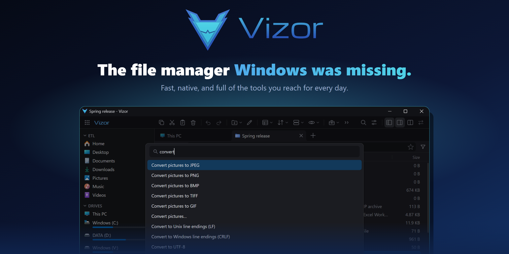
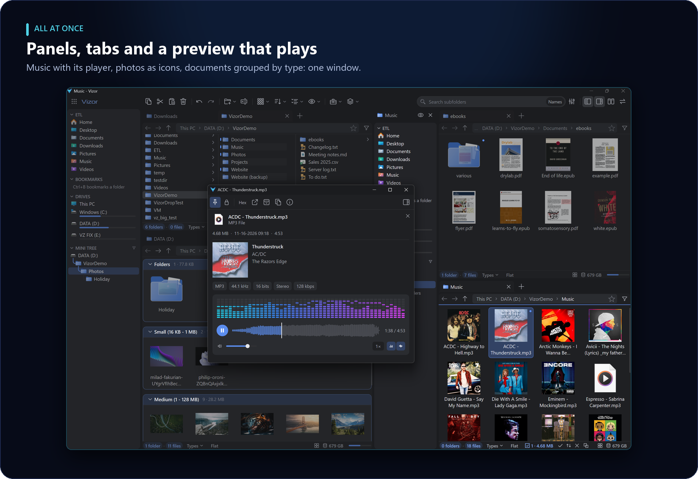
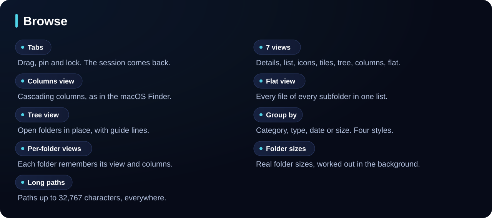
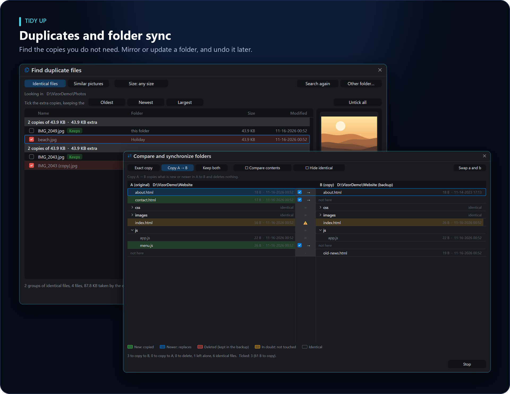
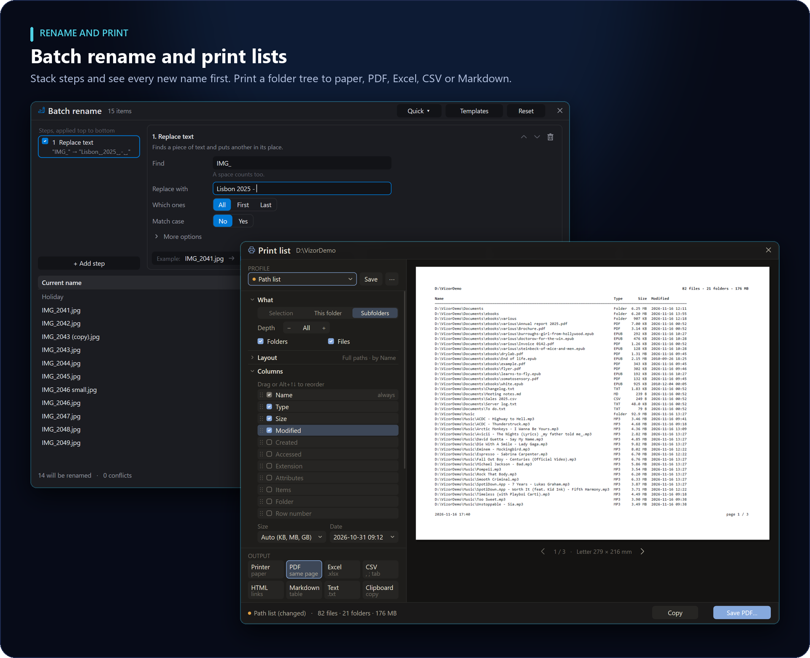
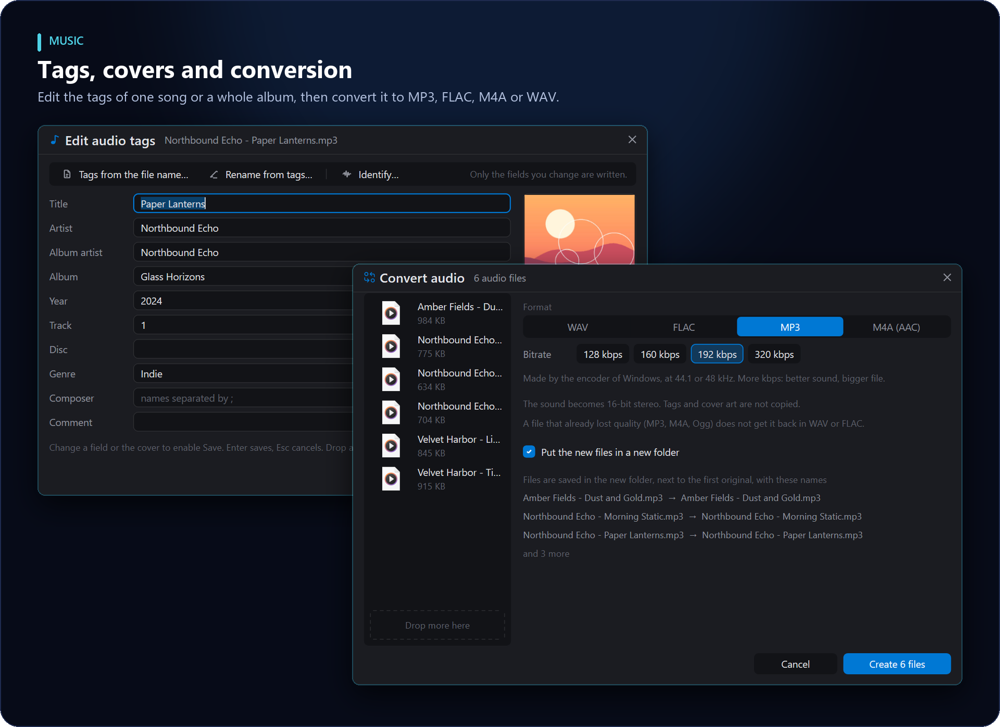

  

# Vizor

Native Windows file manager written in C (Win32 + Direct2D/DirectWrite + WIC), modelled on how File Pilot works.
A single `.exe` with no dependencies (static CRT).

## Features

<b>The same list as text</b>

## Highlights

| | |
|---|---|
| <kbd>⚡ Instant</kbd> | 10,000 files drawn in 1–2 ms. Nothing waits for the disk or the network. |
| <kbd>👁 SwiftView</kbd> | Press Space to preview almost anything: Office, PDF, pictures, audio, video, books. |
| <kbd>⌨ Command palette</kbd> | Every command one keystroke away. Every shortcut can be changed. |
| <kbd>🛡 Safe copy engine</kbd> | Files are never left half-written, even after a crash. Optional verify. |
| <kbd>🪟 Panel layouts</kbd> | Up to four panels in 11 arrangements, each with its own tabs. |
| <kbd>🔄 Compare & sync</kbd> | Two folders side by side, three modes, and Undo, even after a restart. |
| <kbd>👯 Find duplicates</kbd> | Identical files, and similar pictures that were resized or re-saved. |
| <kbd>⏏ Smart eject</kbd> | Says which program holds the drive, and can close it for you. |
| <kbd>🎵 Audio tags</kbd> | Identify songs by their sound, find covers online, rename from tags. |
| <kbd>🔁 Converters</kbd> | Pictures, audio, PDF, documents and data into other formats, in one click. |
| <kbd>📄 PDF tools</kbd> | Merge, split, rotate and extract pages. PDF to Word and Excel. |
| <kbd>🗜 Archives</kbd> | Browse and extract ZIP, 7z, RAR and tar. Create ZIP and 7z with AES-256. |

## Browse

| | |
|---|---|
| <kbd>Tabs</kbd> | Drag, pin and lock tabs. The whole session comes back next time. |
| <kbd>7 views</kbd> | Details, list, icons (32–256 px), tiles, tree, columns and flat. |
| <kbd>Columns view</kbd> | Cascading columns, as in the macOS Finder. |
| <kbd>Flat view</kbd> | Every file of every subfolder in one list. |
| <kbd>Tree view</kbd> | Open folders in place, with guide lines to the item you point at. |
| <kbd>Group by</kbd> | Category, type, date, size or name, with four header styles. |
| <kbd>Per-folder views</kbd> | Each folder remembers its view, sort, columns and groups. |
| <kbd>Folder sizes</kbd> | Real sizes of folders, in the background, per kind of drive. |
| <kbd>Long paths</kbd> | Paths up to 32,767 characters work everywhere. |

## Preview

| | |
|---|---|
| <kbd>Documents</kbd> | Word, Excel, PowerPoint and PDF, safely out of process. |
| <kbd>Pictures</kbd> | Zoom, pan, a mini-map, and rotate the file for good. |
| <kbd>Audio player</kbd> | Cover, tags, waveform and a live glowing spectrum. |
| <kbd>Video</kbd> | Codec, tracks, subtitles and four frames of the film. |
| <kbd>Books & comics</kbd> | Read EPUB, CBZ and CBR in the preview. |
| <kbd>Markdown</kbd> | Rendered, with working links and headings. |
| <kbd>HTML pages</kbd> | Web pages shown as in Microsoft Edge, through WebView2. |
| <kbd>Inside archives</kbd> | See what a ZIP, 7z, RAR or ISO holds without extracting. |
| <kbd>Folder map</kbd> | A folder's structure as a tree with sizes. |
| <kbd>Hex</kbd> | The bytes of any file. |
| <kbd>Own window</kbd> | Move the preview to another screen; it follows the selection. |
| <kbd>DNA files</kbd> | Sequence counts of FASTA and FASTQ files, and AB1 chromatograms with bases and quality. |

## Find and organize

| | |
|---|---|
| <kbd>Search</kbd> | Names or the text inside files, Office documents included. Results as they are found. |
| <kbd>Query syntax</kbd> | `ext:pdf size:>10MB modified:<7d tag:work`, with suggestions. |
| <kbd>Advanced search</kbd> | A simple form that builds the query for you, regular expressions included. Save searches. |
| <kbd>Tags</kbd> | Colors and words, kept even when files are renamed or moved. |
| <kbd>Workspaces</kbd> | Collect files from anywhere into one virtual folder. |
| <kbd>Comments</kbd> | A note on any file or folder, in its own column. |
| <kbd>Folder colors</kbd> | Ten colors or your own, plus 40 glyphs on the folder. |
| <kbd>Folder contents</kbd> | Big folder icons show what they hold, photos included. |

## Work with files

| | |
|---|---|
| <kbd>Undo / Redo</kbd> | Rename, move, copy, create and delete, all undoable. |
| <kbd>Batch rename</kbd> | 15 kinds of steps, EXIF and regex, a live preview and templates. |
| <kbd>Advanced paste</kbd> | Paste only newer, only changed, or verified. |
| <kbd>Edit dates</kbd> | Change created, modified and accessed dates of many files at once. |
| <kbd>Drag & drop</kbd> | Between panels, tabs, the sidebar and other programs. |
| <kbd>Context menu</kbd> | Searchable, with favorites. Three styles, Windows 11 included. |
| <kbd>Recycle Bin</kbd> | Browse it, restore files, see where they came from. |
| <kbd>Clean up</kbd> | Find and remove empty files and folders. |
| <kbd>Unlock file</kbd> | See which program holds a file, and close it. |
| <kbd>Checksums</kbd> | MD5, SHA-1, SHA-256, CRC-32, xxHash64. Create and verify. |
| <kbd>Split & join</kbd> | Cut big files into parts and put them back together. |
| <kbd>Print list</kbd> | A folder's contents to the printer, PDF, Excel, CSV or HTML. |
| <kbd>Text statistics</kbd> | Lines, words, encoding and line endings of many text files at once. |
| <kbd>Passwords</kbd> | A lock on protected files; remove a PDF password you know. |

## Convert

| | |
|---|---|
| <kbd>Pictures</kbd> | Resize, and convert to JPEG, PNG, BMP, TIFF, GIF or ICO. |
| <kbd>To PDF</kbd> | Pictures or text files into PDF. |
| <kbd>From PDF</kbd> | PDF to Word, Excel, text, PNG or JPEG. |
| <kbd>Audio</kbd> | To WAV, FLAC, MP3 or M4A. Change the volume. |
| <kbd>Text</kbd> | Line endings, encodings, Base64. |
| <kbd>Data</kbd> | CSV, TSV, JSON and Markdown tables. SRT ↔ VTT subtitles. |

## Make it yours

| | |
|---|---|
| <kbd>Themes</kbd> | Six color schemes, light and dark, following Windows. |
| <kbd>Icon styles</kbd> | Nine toolbar icon styles. |
| <kbd>Settings</kbd> | Over 160 options, all searchable. |
| <kbd>Profiles</kbd> | Save, load and share your whole setup. |
| <kbd>Keyboard first</kbd> | Vim keys, type to filter, every command with a key. |
| <kbd>Explorer menu</kbd> | "Open in Vizor" in the File Explorer menu (optional). |

## License

Vizor is free for personal, educational and non-profit use. Commercial use needs a commercial license.
Read the full terms in [LICENSE.md](LICENSE.md) (English) or [LICENCIA.md](LICENCIA.md) (Spanish; it prevails if they differ).
